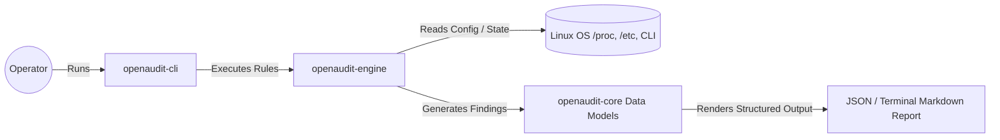
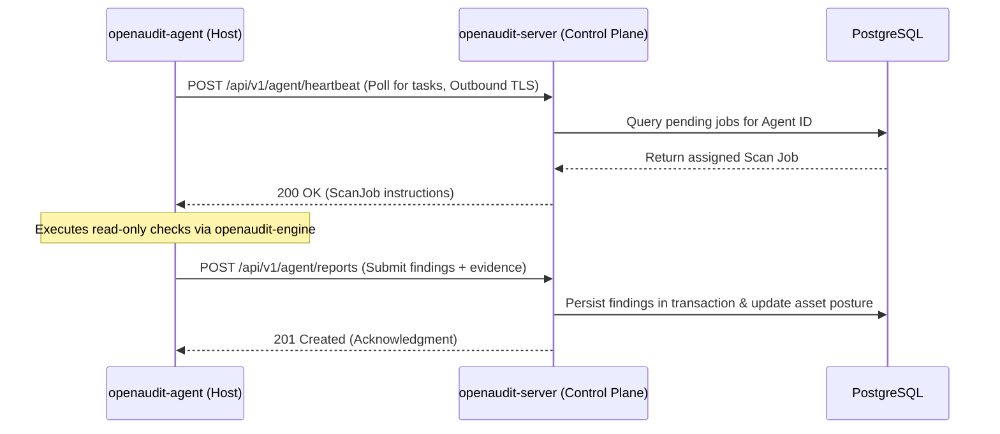
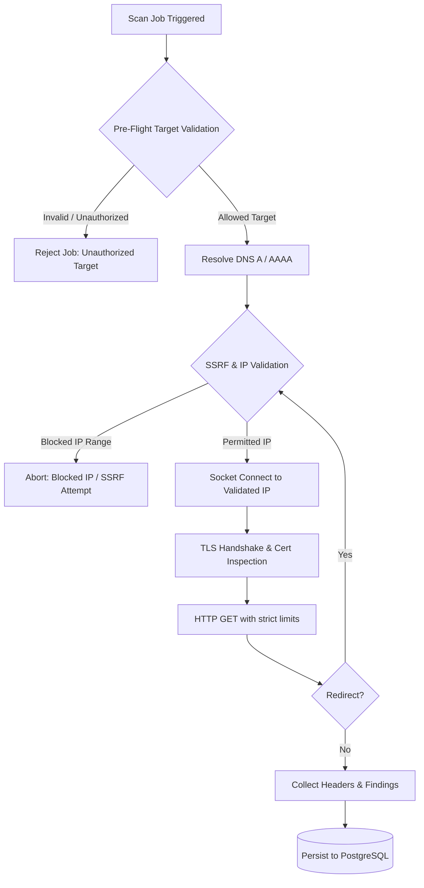
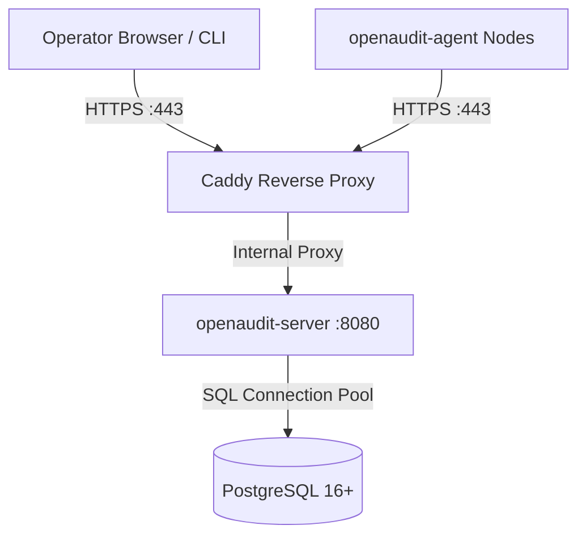
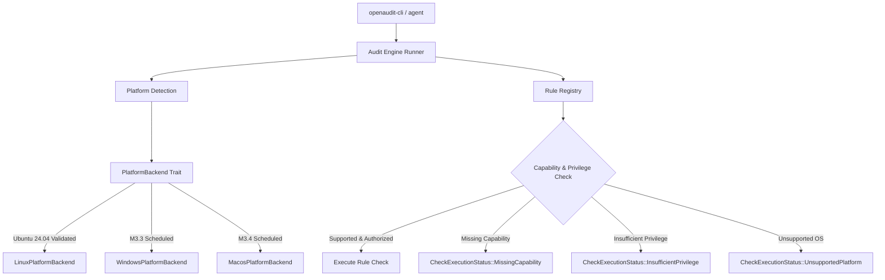

# OpenAudit System Architecture

This document defines the architectural boundaries, component responsibilities, data flows, communication patterns, and technical decisions governing the OpenAudit platform.

---

## 1. System Overview & Workspace Boundaries

OpenAudit is organized as a modular Rust workspace. To avoid premature distributed system complexity and excessive crate boundary churn, OpenAudit adopts a **modular monolith** foundation consisting of two core libraries and three application binaries:

```text
openaudit/
├── crates/
│   ├── openaudit-core/       # Domain primitives, common models, validation, and error types
│   └── openaudit-engine/     # Pluggable audit check execution engine and rule definitions
│
├── apps/
│   ├── openaudit-cli/        # Standalone operator CLI (local host audits & server client)
│   ├── openaudit-server/     # Control plane API, storage persistence, and task scheduler
│   └── openaudit-agent/      # Minimal, outbound-only host monitoring daemon
│
├── docs/                     # Architectural, threat model, research, and roadmap documentation
├── .github/workflows/        # Continuous integration workflows
├── Cargo.toml                # Workspace manifest
└── rust-toolchain.toml       # Pinned Rust compiler toolchain
```

### Component Responsibilities

| Component | Type | Responsibility | Key Dependencies (Planned) |
|---|---|---|---|
| `openaudit-core` | Library | Houses core domain entities (`Asset`, `Scan`, `Finding`, `Severity`, `Evidence`), identifier types (`AssetId`, `ScanId`), time utilities, and domain-wide error definitions. Completely decoupled from transport, databases, or OS-specific syscalls. | `serde`, `uuid`, `thiserror`, `chrono` |
| `openaudit-engine` | Library | Encapsulates the execution logic for audit rules. Houses both local Linux system checks (parsing `/proc`, `/sys`, config files, package lists) and external network checks (DNS, TLS, HTTP headers). | `openaudit-core`, `tracing` |
| `openaudit-cli` | Binary | The primary entry point for developers and operators. Can execute local host audits directly in a standalone, zero-daemon mode (`openaudit-cli audit local`), or query a remote OpenAudit server instance. | `openaudit-core`, `openaudit-engine`, `clap` |
| `openaudit-server` | Binary | The central control plane. Serves the authenticated REST/JSON API, enforces tenant isolation, persists scan records to PostgreSQL, and schedules asynchronous scan jobs via an embedded PostgreSQL task queue. | `openaudit-core`, `axum`, `tokio`, `sqlx`, `tower-http` |
| `openaudit-agent` | Binary | An optional, lightweight background service deployed on monitored Linux nodes. Periodically polls the control plane for assigned audit tasks, runs read-only host checks via `openaudit-engine`, and submits structured findings over outbound HTTPS. | `openaudit-core`, `openaudit-engine`, `tokio`, `reqwest` |

---

## 2. Auditing Paradigms & Data Flow

OpenAudit combines two distinct auditing paradigms to provide both internal system depth and external perimeter visibility.

### A. Local / Standalone CLI Auditing (Proof of Value)

The primary initial deliverable of OpenAudit is the ability for an operator to run an audit locally without needing to spin up a database or server daemon:



1. The operator invokes `openaudit-cli audit local`.
2. `openaudit-engine` reads local operating system status (e.g., `/etc/ssh/sshd_config`, `/proc/net/tcp`, package manager queries).
3. Findings are evaluated against declarative rules and converted into typed `Finding` records.
4. Output is rendered directly to stdout in human-readable Markdown or machine-readable JSON.

### B. Centralized Agent-Based Host Auditing

For ongoing fleet monitoring, monitored servers run `openaudit-agent`:



#### Key Agent Design Constraints
- **Zero Inbound Ports:** The agent never binds a listening network port. All communication is strictly outbound over TLS to the control plane.
- **Strictly Read-Only:** The agent only reads system configuration files, queries service states via systemd, and checks listening sockets. It never modifies firewall rules, service states, or files.
- **No Remote Shell Execution:** The agent protocol does not support arbitrary command execution or dynamic script evaluation. Only predefined, statically compiled check identifiers with bounded parameters can be requested by the control plane.

### C. Agentless External Perimeter Auditing

OpenAudit inspects public or authorized internal endpoints directly from `openaudit-server` or worker tasks:



---

## 3. Security Boundary & Target Validation Architecture

### SSRF & Network Validation Policy
Agentless scanning introduces severe Server-Side Request Forgery (SSRF) and target expansion risks if not tightly controlled. OpenAudit enforces a multi-layered defense:

1. **Default Denylist:** By default, all scan requests to the following IP ranges are strictly blocked:
   - Loopback addresses (`127.0.0.0/8`, `::1/128`)
   - RFC 1918 Private IPv4 (`10.0.0.0/8`, `172.16.0.0/12`, `192.168.0.0/16`)
   - RFC 3927 Link-Local (`169.254.0.0/16`, `fe80::/10`)
   - Cloud Metadata Service IP (`169.254.169.254`)
   - RFC 6598 Carrier-Grade NAT (`100.64.0.0/10`)
   - Multicast, broadcast, and reserved ranges (`224.0.0.0/4`, `240.0.0.0/4`, `0.0.0.0/8`)
   - IPv6 Unique Local Addresses (ULA `fc00::/7`)

2. **Explicit Administrator Allowlists:**
   - In environments where OpenAudit is legitimately tasked with auditing internal networks, an administrator must explicitly register approved CIDR blocks or domain patterns in the control plane database.
   - Any target resolving outside the explicitly approved scope is rejected immediately.

3. **DNS Rebinding & TOCTOU Defense:**
   - Standard HTTP clients resolve DNS and connect in separate operations, creating a Time-of-Check to Time-of-Use (TOCTOU) vulnerability where a malicious DNS server returns a public IP during validation but a private IP during socket connection.
   - **Mitigation:** OpenAudit performs custom DNS resolution, validates the resolved IP addresses against the allowlist/denylist, and establishes the TCP connection directly to the validated IP address, passing the target hostname explicitly via the HTTP `Host` header and TLS Server Name Indication (SNI).

4. **Redirect Revalidation:**
   - HTTP redirects are not followed automatically by default.
   - If redirects are enabled for a scan profile, the redirect destination URL is parsed, DNS-resolved, and subjected to the complete SSRF IP validation pipeline before any redirect socket is opened. Max redirect depth is strictly capped (default: 3 hops).

5. **Resource Bounding:**
   - Connection timeout: 10 seconds maximum.
   - Read timeout: 10 seconds maximum.
   - Response body streaming limit: 512 KB maximum (discarding trailing bytes to prevent memory exhaustion from response bombs).

---

## 4. Agent Authentication & Identity Management

Agent security is critical to prevent rogue nodes from impersonating legitimate infrastructure or submitting fabricated audit reports.

### Trade-Off Analysis: Ed25519 Asymmetric Keys vs. Hashed Bearer Tokens

| Attribute | Asymmetric Key Pairs (Ed25519) | Cryptographically Hashed Bearer Tokens |
|---|---|---|
| **Mechanism** | Agent generates an Ed25519 key pair locally. Public key is registered with control plane; agent signs requests or authenticates via mTLS/signed payloads. | Agent receives a high-entropy secret token (e.g., 256-bit random). The control plane stores an Argon2id or SHA-256 hash of the token. |
| **Credential Exposure at Server** | Zero. If the control plane database is compromised, the attacker only acquires public keys and cannot impersonate agents. | Secure against offline cracking if salted and hashed with Argon2id, but slightly higher exposure than asymmetric keys. |
| **Revocation** | Simple: Mark public key as revoked or deleted in the database. | Simple: Invalidate token record in database. |
| **Implementation Complexity** | Requires custom HTTP request signing header standard (e.g., RFC 9421 / HTTP Message Signatures) or mutual TLS (mTLS) with custom certificate management. | Standard HTTP `Authorization: Bearer <token>` over HTTPS. Standardized, well-vetted, supported by all HTTP libraries. |
| **Replay Attack Defense** | Requires timestamp / nonce validation in signature verification. | Relies on transport layer security (TLS) + token expiry/rotation. |
| **Operational Overhead** | Key generation, CSR/enrollment handshake, signature debugging. | Straightforward bootstrap token exchange. |

### Architectural Decision: Phased Identity Model
1. **Initial Implementation (M5): Hashed Bearer Tokens via Bootstrap Exchange**
   - The operator generates a one-time, time-limited **Enrollment Token** in the control plane.
   - The agent registers using this token over HTTPS.
   - The server issues a persistent, unique **Agent Secret Token**, storing only its Argon2id hash in the database.
   - The agent authenticates all subsequent requests using `Authorization: Bearer <token>` over HTTPS.
   - Any compromised token can be revoked instantly by the administrator in the database.
2. **Future Hardening:** Evaluate Ed25519 request signing or mTLS once the fleet orchestration primitives have stabilized, avoiding premature custom cryptographic protocols in early milestones.

---

## 5. Persistence & Task Queue Architecture

### PostgreSQL as the Single Source of Truth
To minimize operational overhead on modest VPS deployments, OpenAudit eliminates external message broker dependencies (such as Redis or RabbitMQ) by leveraging PostgreSQL for both persistent state and job orchestration.

#### Transactional Task Queue with `FOR UPDATE SKIP LOCKED`
Background scan execution uses PostgreSQL as an ACID-compliant, reliable queue:

```sql
-- Worker retrieves the next pending job atomically without blocking concurrent workers
WITH next_job AS (
    SELECT id
    FROM scan_jobs
    WHERE status = 'queued' 
      AND scheduled_at <= NOW()
    ORDER BY scheduled_at ASC, priority DESC
    LIMIT 1
    FOR UPDATE SKIP LOCKED
)
UPDATE scan_jobs
SET status = 'running',
    started_at = NOW(),
    worker_id = $1
FROM next_job
WHERE scan_jobs.id = next_job.id
RETURNING scan_jobs.*;
```

**Benefits:**
- **Zero Extra Daemons:** No Redis or message broker to monitor, backup, or secure.
- **Strict Data Consistency:** Jobs and scan records live within the same transactional database. If a database transaction rolls back, job state consistency is preserved.
- **Low Memory Footprint:** PostgreSQL handles connections and indexing efficiently within standard memory constraints.

For the comprehensive relational entity design, Row-Level Security (RLS) policies, finding deduplication state machine, and evidence retention rules, see [DATA-MODEL.md](DATA-MODEL.md).

---

## 6. Observability & Structured Logging

OpenAudit standardizes on the `tracing` ecosystem across all crates and binaries:

- **Structured Key-Value Spans:** Every scan execution, API request, and agent polling cycle is bound to a structured trace span carrying `organization_id`, `asset_id`, and `scan_id`.
- **Environment Filter:** Configured via `RUST_LOG` with sensible defaults (e.g., `info,openaudit=debug`).
- **Log Formatting:** Standard human-readable formatting in development CLI contexts and machine-readable JSON in production server/container deployments.
- **No Logged Secrets:** Explicit filter sanitizers prevent logging bearer tokens, private keys, or raw unsanitized evidence payloads.

---

## 7. Deployment Architecture

For self-hosted production deployments, OpenAudit is packaged as a lightweight Docker Compose deployment:



- **Caddy:** Serves as the edge TLS terminator with automated Let's Encrypt certificate management and HTTP/2 support.
- **openaudit-server:** Stateless application binary handling API routes and embedded job processing.
- **PostgreSQL:** Stores asset metadata, scan schedules, findings, audit trails, and the job queue.

---

## 8. Platform Abstraction & Capability Model

Beginning in Milestone M3, OpenAudit establishes a typed platform abstraction layer enabling a single unified Rust audit engine (`openaudit-engine`) to support cross-platform inspection while maintaining strict fail-closed safety.

### A. Architectural Boundaries



### B. Core Abstraction Types

1. **`PlatformBackend` Trait:**
   Defines the contract for platform detection, capability queries, and host inspection collection:
   - `platform_info(&self) -> &PlatformInfo`: Access platform family, distribution, and version.
   - `capabilities(&self) -> &[PlatformCapability]`: Query supported host inspection primitives.
   - `has_capability(&self, cap: PlatformCapability) -> bool`: Constant-time capability check.
   - `is_supported(&self) -> bool`: Explicit platform support gate.
   - `collect_context(&self) -> Result<HostInspectionContext, EngineError>`: Gather typed inspection state.

2. **`PlatformCapability` Enumeration:**
   Granular capabilities decoupling rules from platform-specific APIs:
   - Linux: `KernelSysctl`, `Firewall`, `ListeningPorts`, `FilePermissions`, `SystemUsers`, `SuidSgidBinaries`, `SshDaemon`, `EnvironmentVariables`.
   - Windows (M3.3): `WindowsRegistry`, `WindowsDefender`.
   - macOS (M3.4): `MacosGatekeeper`, `MacosSip`.

3. **`CheckExecutionStatus` Lifecycle:**
   Every check registered in an audit run is tracked deterministically in the final `AuditReport`:
   - `Executed { passed: bool }`: Check executed cleanly; findings recorded if `passed == false`.
   - `SkippedDisabled`: Check disabled by operator profile.
   - `MissingCapability { capability: PlatformCapability }`: Platform lacks the required OS capability.
   - `InsufficientPrivilege { required: PrivilegeLevel, current: PrivilegeLevel }`: Non-root context prevented rule evaluation.
   - `UnsupportedPlatform { family: PlatformFamily, distribution: PlatformDistribution, reason: String }`: Explicit, fail-closed platform rejection.

### C. Linux Multi-Distribution Matrix & Validation Tiers

Beginning in Milestone M3.2, OpenAudit expands its Linux reference backend from Ubuntu 24.04 LTS to officially support Debian 12 (Bookworm) and Debian 13 (Trixie).

#### Validated Linux Platform Matrix

| Distribution | Version | Target Name | Status | Validation Tiers |
|---|---|---|---|---|
| **Ubuntu** | 24.04 LTS | Noble Numbat | Supported | Container-tested (`openaudit-ci:ubuntu-24.04`), Mock-tested, Native Linux VM |
| **Debian** | 12 | Bookworm | Supported | Container-tested (`openaudit-ci:debian-12`), Mock-tested |
| **Debian** | 13 | Trixie | Supported | Container-tested (`openaudit-ci:debian-13`), Mock-tested |
| **Debian** | < 12 | Legacy / EOL | Unsupported | Fails closed with typed rejection |
| **Ubuntu** | != 24.04 | Non-Noble | Unsupported | Fails closed with typed rejection |
| **RHEL / Alpine / Arch** | All | Other Linux | Unsupported | Fails closed with typed rejection |

#### Validation Methodology & Verification Tiers
OpenAudit strictly distinguishes between verification environments and never conflates container execution with native kernel qualification:
1. **Container-Tested:** Executed inside real distribution OCI images (`debian:12-slim`, `debian:trixie-slim`, `ubuntu:24.04`) containing the distribution's libc, filesystem layout, service configuration files, and package tooling.
2. **Native Distribution-Tested:** Executed on a dedicated machine or full virtual machine running the distribution's native kernel and systemd init.
3. **Mock-Tested:** Deterministic in-memory filesystem (`FileSystem`) and process execution (`CommandRunner`) suites verifying edge cases, syntax variations, and permission boundaries.

#### Binary Compatibility & glibc Boundaries
- Ubuntu 24.04 links dynamically against glibc 2.39+.
- Debian 12 ships with glibc 2.36, preventing dynamic execution of Ubuntu 24.04-built binaries on Debian 12 hosts without recompilation or static linking.
- Debian 13 ships with glibc 2.41+, providing forward dynamic compatibility for Ubuntu 24.04 ELF binaries.
- Each distribution's verification container compiles and verifies OpenAudit against its native glibc and userland tooling.

### D. Windows Native Audit Architecture (Milestone M3.3)

Milestone M3.3 establishes a native Windows audit backend (`WindowsPlatformBackend`) integrated into the shared Rust engine. The backend directly gathers host telemetry through native Windows administration tools and registry interfaces, bypassing Unix-centric abstractions.

#### Validated Windows Platform Targets

| Platform / Edition | Build Requirement | Status | Validation Tiers |
|---|---|---|---|
| **Windows 11** | Build >= 22000 | Supported | Native Windows Runner (`windows-latest`), Mock-tested (`windows_compatibility_regression.rs`) |
| **Windows Server 2022** | Build == 20348 | Supported | Native Windows Runner, Mock-tested |
| **Windows Server 2025** | Build >= 26100 | Supported | Native Windows Runner, Mock-tested |
| **Windows 10** | Build 10240..21999 | Unsupported | Fails closed with typed `EngineError::UnsupportedPlatform` |
| **Windows 7 / 8 / 8.1** | Legacy | Unsupported | Fails closed with typed `EngineError::UnsupportedPlatform` |
| **Windows Server 2012 / 2016** | Legacy | Unsupported | Fails closed with typed `EngineError::UnsupportedPlatform` |

#### Windows Telemetry Collection Architecture

1. **Elevation & Privilege Detection:**
   Privilege level is detected by inspecting process tokens via `whoami /groups` looking for the built-in Administrator group SID (`S-1-5-32-544`) and `High Mandatory Level`. Non-elevated execution gracefully flags checks requiring elevation with `CheckExecutionStatus::InsufficientPrivilege`.

2. **Subprocess & Registry Queries:**
   - **Defender State:** `Get-MpComputerStatus` via PowerShell without profile loading (`-NoProfile -NonInteractive`).
   - **Firewall Profiles:** `netsh.exe advfirewall show allprofiles` parsing Domain, Private, and Public profiles.
   - **Security Registry:** `reg.exe query` checking UAC (`EnableLUA`), legacy SMBv1 (`SMB1`), LSA protection (`RunAsPPL`), and WDigest plaintext credential caching.
   - **Services:** `Get-CimInstance Win32_Service` scanning for unquoted binary paths with embedded spaces.
   - **Local Accounts:** `Get-LocalUser` and `Get-LocalGroupMember` detecting active Guest accounts and empty password requirements.
   - **Network Exposure:** `netstat.exe -ano -p tcp` resolving wildcard listening sockets on SMB (445) and RDP (3389).

#### 12 Native Windows Security Rules

| Rule ID | Title | Severity | Security Domain |
|---|---|---|---|
| `windows.defender.realtime-disabled` | Defender Real-Time Protection Disabled | Critical | Endpoint Antivirus |
| `windows.defender.antivirus-disabled` | Defender Antivirus Engine Inactive | High | Endpoint Antivirus |
| `windows.firewall.profile-disabled` | Firewall Profile Disabled | High | Network Perimeter |
| `windows.registry.uac-disabled` | User Account Control (UAC) Disabled | Critical | System Integrity |
| `windows.registry.smbv1-enabled` | Legacy SMBv1 Protocol Enabled | High | Protocol Security |
| `windows.registry.lsa-protection-disabled` | LSA Credential Guard (RunAsPPL) Disabled | High | Memory & LSASS |
| `windows.services.unquoted-path` | Unquoted Windows Service Path | Medium | Privilege Escalation |
| `windows.accounts.guest-enabled` | Built-in Guest Account Active | High | Account Posture |
| `windows.accounts.empty-password` | Account Without Password Required | Critical | Account Posture |
| `windows.ports.exposed-smb` | Exposed Windows SMB Port 445 | High | Network Exposure |
| `windows.ports.exposed-rdp` | Exposed Remote Desktop Protocol (RDP) 3389 | Medium | Network Exposure |
| `windows.fs.writable-system-path` | Writable Directory in System PATH | High | Binary Hijacking |

#### Windows Validation Policy & Tiers
- **Native Verification:** Continuous integration executes on GitHub Actions `windows-latest` running the real Rust compiler, Clippy, and test suite on native Windows.
- **In-Memory Regression Suite:** Deterministic unit and integration tests (`windows_compatibility_regression.rs`) verify end-to-end audit execution, finding scoring, redaction, and fail-closed rejections.
- **Strict Isolation from Docker:** Docker containers on macOS or Linux cannot execute Windows binaries or test Windows kernel semantics. OpenAudit never claims native Windows validation based on Docker execution.

### E. Fail-Closed Guarantees & Linux Engine Preservation

- **Strict Fail-Closed Semantics:** On unsupported platforms (macOS M3.4 or unvalidated Linux/Windows distributions), OpenAudit rejects execution with typed `EngineError::UnsupportedPlatform` and records `CheckExecutionStatus::UnsupportedPlatform`. No synthetic or simulated audit data is ever returned.
- **M2 Linux Engine Preservation:** The complete M2 Linux audit engine (20 built-in rules, privilege checks, `/proc`, `/sys`, and config collectors) operates identically through `LinuxPlatformBackend`, with 100% regression test coverage in the verified Ubuntu 24.04 LTS, Debian 12, and Debian 13 environments.
