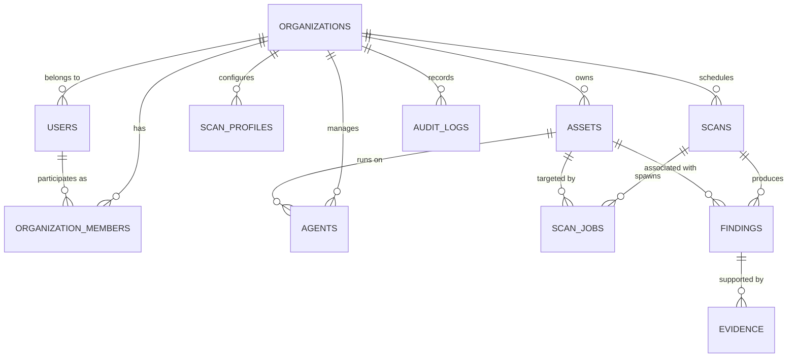

# OpenAudit PostgreSQL Data Model & Schema Architecture

This document defines the multi-tenant relational schema design for OpenAudit's PostgreSQL storage layer, covering entity definitions, tenant isolation, Row-Level Security (RLS), task queueing, finding deduplication, and evidence retention.

---

## 1. Schema Design Principles

1. **Strict Multi-Tenancy:** Every core domain table references an `organization_id`. Tenant data isolation is enforced at the query level and reinforced by PostgreSQL Row-Level Security (RLS).
2. **UUID Primary Keys:** All primary keys use UUIDv7 (or UUIDv4) to prevent enumeration attacks, simplify client-side ID generation, and allow distributed generation without database round-trips.
3. **No Plaintext Secrets:** Authentication tokens, agent enrollment secrets, and API credentials are never stored in plaintext; high-entropy tokens are hashed with Argon2id prior to persistence.
4. **Non-Destructive History:** Scans and findings preserve historical records to enable point-in-time drift comparisons. Findings track lifecycle states rather than being deleted upon resolution.
5. **Data Minimization & Evidence Redaction:** Evidence payloads are subject to strict size caps (max 512 KB) and automated pre-persistence secret redaction.

---

## 2. Entity Relationship Overview



---

## 3. Core Entities Specification

### 1. `organizations`
Tenant boundary container.
- `id` (UUID, PK)
- `name` (VARCHAR(255), NOT NULL)
- `slug` (VARCHAR(64), UNIQUE, NOT NULL)
- `created_at` (TIMESTAMPTZ, NOT NULL DEFAULT NOW())
- `updated_at` (TIMESTAMPTZ, NOT NULL DEFAULT NOW())

### 2. `users`
Global user identities.
- `id` (UUID, PK)
- `email` (VARCHAR(320), UNIQUE, NOT NULL)
- `password_hash` (TEXT, NOT NULL) — Argon2id hash
- `full_name` (VARCHAR(255))
- `is_active` (BOOLEAN, NOT NULL DEFAULT TRUE)
- `created_at` (TIMESTAMPTZ, NOT NULL DEFAULT NOW())
- `updated_at` (TIMESTAMPTZ, NOT NULL DEFAULT NOW())

### 3. `organization_members`
RBAC mapping associating users with organizations.
- `id` (UUID, PK)
- `organization_id` (UUID, FK -> organizations.id, NOT NULL)
- `user_id` (UUID, FK -> users.id, NOT NULL)
- `role` (VARCHAR(32), NOT NULL) — `owner`, `admin`, `auditor`, `viewer`
- `created_at` (TIMESTAMPTZ, NOT NULL DEFAULT NOW())
- UNIQUE(`organization_id`, `user_id`)

### 4. `assets`
Monitored infrastructure nodes (servers, domains, or network endpoints).
- `id` (UUID, PK)
- `organization_id` (UUID, FK -> organizations.id, NOT NULL)
- `name` (VARCHAR(255), NOT NULL)
- `asset_type` (VARCHAR(32), NOT NULL) — `linux_host`, `web_domain`, `ip_endpoint`
- `target_address` (VARCHAR(512), NOT NULL) — hostname, FQDN, or allowed IP
- `environment` (VARCHAR(32), NOT NULL DEFAULT 'production') — `production`, `staging`, `development`
- `criticality` (VARCHAR(32), NOT NULL DEFAULT 'medium') — `low`, `medium`, `high`, `critical`
- `tags` (JSONB, NOT NULL DEFAULT '[]')
- `is_active` (BOOLEAN, NOT NULL DEFAULT TRUE)
- `created_at` (TIMESTAMPTZ, NOT NULL DEFAULT NOW())
- `updated_at` (TIMESTAMPTZ, NOT NULL DEFAULT NOW())

### 5. `agents`
Registered instances of `openaudit-agent`.
- `id` (UUID, PK)
- `organization_id` (UUID, FK -> organizations.id, NOT NULL)
- `asset_id` (UUID, FK -> assets.id, UNIQUE, NULLABLE) — 1:1 binding to an asset once enrolled
- `token_hash` (TEXT, NOT NULL) — Argon2id hash of agent's bearer secret
- `hostname` (VARCHAR(255), NOT NULL)
- `os_info` (JSONB, NOT NULL DEFAULT '{}') — distribution, kernel version, architecture
- `agent_version` (VARCHAR(32), NOT NULL)
- `status` (VARCHAR(32), NOT NULL DEFAULT 'enrolled') — `enrolled`, `active`, `offline`, `revoked`
- `last_heartbeat_at` (TIMESTAMPTZ)
- `created_at` (TIMESTAMPTZ, NOT NULL DEFAULT NOW())
- `revoked_at` (TIMESTAMPTZ)

### 6. `scan_profiles`
Configuration templates defining what rules and policies apply during scans.
- `id` (UUID, PK)
- `organization_id` (UUID, FK -> organizations.id, NOT NULL)
- `name` (VARCHAR(255), NOT NULL)
- `profile_type` (VARCHAR(32), NOT NULL) — `linux_host_audit`, `external_perimeter`
- `ruleset_config` (JSONB, NOT NULL DEFAULT '{}') — enabled check IDs, severity filters
- `timeout_seconds` (INT, NOT NULL DEFAULT 60)
- `max_redirects` (INT, NOT NULL DEFAULT 0) — SSRF limit, max 3
- `created_at` (TIMESTAMPTZ, NOT NULL DEFAULT NOW())

### 7. `scans`
High-level scan executions (recurring schedule or ad-hoc).
- `id` (UUID, PK)
- `organization_id` (UUID, FK -> organizations.id, NOT NULL)
- `scan_profile_id` (UUID, FK -> scan_profiles.id, NOT NULL)
- `trigger_type` (VARCHAR(32), NOT NULL) — `manual`, `scheduled`
- `status` (VARCHAR(32), NOT NULL DEFAULT 'pending') — `pending`, `running`, `completed`, `failed`
- `summary_counts` (JSONB, NOT NULL DEFAULT '{"critical":0,"high":0,"medium":0,"low":0,"info":0}')
- `started_at` (TIMESTAMPTZ)
- `completed_at` (TIMESTAMPTZ)
- `created_at` (TIMESTAMPTZ, NOT NULL DEFAULT NOW())

### 8. `scan_jobs`
Atomic work units consumed by workers or polled by agents using `SELECT ... FOR UPDATE SKIP LOCKED`.
- `id` (UUID, PK)
- `scan_id` (UUID, FK -> scans.id, NOT NULL)
- `organization_id` (UUID, FK -> organizations.id, NOT NULL)
- `asset_id` (UUID, FK -> assets.id, NOT NULL)
- `job_type` (VARCHAR(32), NOT NULL) — `local_agent_audit`, `agentless_perimeter`
- `status` (VARCHAR(32), NOT NULL DEFAULT 'queued') — `queued`, `running`, `completed`, `failed`
- `priority` (INT, NOT NULL DEFAULT 0)
- `worker_id` (VARCHAR(128))
- `attempts` (INT, NOT NULL DEFAULT 0)
- `max_attempts` (INT, NOT NULL DEFAULT 3)
- `scheduled_at` (TIMESTAMPTZ, NOT NULL DEFAULT NOW())
- `started_at` (TIMESTAMPTZ)
- `completed_at` (TIMESTAMPTZ)
- `error_message` (TEXT)

### 9. `findings`
Security issues identified during scans.
- `id` (UUID, PK)
- `organization_id` (UUID, FK -> organizations.id, NOT NULL)
- `asset_id` (UUID, FK -> assets.id, NOT NULL)
- `first_scan_id` (UUID, FK -> scans.id, NOT NULL)
- `last_scan_id` (UUID, FK -> scans.id, NOT NULL)
- `fingerprint` (CHAR(64), NOT NULL) — SHA-256 of `(asset_id, rule_id, check_target)` for deduplication
- `rule_id` (VARCHAR(128), NOT NULL) — e.g. `ssh-disable-root-login`
- `title` (VARCHAR(512), NOT NULL)
- `severity` (VARCHAR(16), NOT NULL) — `info`, `low`, `medium`, `high`, `critical`
- `status` (VARCHAR(32), NOT NULL DEFAULT 'active') — `active`, `resolved`, `suppressed`
- `description` (TEXT, NOT NULL)
- `remediation` (TEXT, NOT NULL)
- `cwe_id` (VARCHAR(32)) — e.g. `CWE-306`
- `first_seen_at` (TIMESTAMPTZ, NOT NULL DEFAULT NOW())
- `last_seen_at` (TIMESTAMPTZ, NOT NULL DEFAULT NOW())
- `resolved_at` (TIMESTAMPTZ)
- UNIQUE(`organization_id`, `fingerprint`)

### 10. `evidence`
Sanitized supporting technical data for a finding.
- `id` (UUID, PK)
- `finding_id` (UUID, FK -> findings.id, NOT NULL)
- `scan_id` (UUID, FK -> scans.id, NOT NULL)
- `evidence_type` (VARCHAR(64), NOT NULL) — `config_excerpt`, `socket_state`, `header_dump`
- `raw_data` (JSONB, NOT NULL) — strictly sanitized & redacted
- `is_redacted` (BOOLEAN, NOT NULL DEFAULT TRUE)
- `size_bytes` (INT, NOT NULL)
- `retained_until` (TIMESTAMPTZ, NOT NULL) — default 90 days retention
- `created_at` (TIMESTAMPTZ, NOT NULL DEFAULT NOW())

### 11. `audit_logs`
Immutable administrative audit log of operator actions.
- `id` (UUID, PK)
- `organization_id` (UUID, FK -> organizations.id, NOT NULL)
- `actor_id` (UUID, FK -> users.id, NULLABLE)
- `action` (VARCHAR(128), NOT NULL) — e.g. `agent.enrolled`, `asset.created`, `scan.triggered`, `agent.revoked`
- `target_type` (VARCHAR(64), NOT NULL)
- `target_id` (VARCHAR(128), NOT NULL)
- `details` (JSONB, NOT NULL DEFAULT '{}')
- `ip_address` (INET)
- `created_at` (TIMESTAMPTZ, NOT NULL DEFAULT NOW())

---

## 4. Finding Deduplication & Historical Comparison

### Deduplication Architecture
To avoid finding fatigue, findings are deduplicated using a deterministic cryptographic fingerprint:
$$\text{fingerprint} = \text{SHA-256}(\text{asset\_id} \mathbin{\Vert} \text{rule\_id} \mathbin{\Vert} \text{check\_target})$$

When a scan completes:
1. If a finding with the same fingerprint exists in `active` state: update `last_seen_at` and `last_scan_id`.
2. If a previously `resolved` finding is re-detected: transition state back to `active`, update `last_seen_at`.
3. If an existing `active` finding for the asset was **not** detected during a successful scan targeting that rule: transition state to `resolved`, setting `resolved_at = NOW()`.
4. If the finding is new: insert with state `active`, setting `first_seen_at = NOW()`.

This state machine enables clear historical diffs between scan runs:
- **New findings:** First detected in the current scan.
- **Resolved findings:** Detected previously, but remediated.
- **Persistent findings:** Detected across multiple consecutive scans.

---

## 5. Row-Level Security (RLS) Strategy

As a defense-in-depth measure, PostgreSQL Row-Level Security ensures that tenant isolation cannot be bypassed even if an application query omits an `organization_id` filter:

```sql
-- Enable RLS on core tenant tables
ALTER TABLE assets ENABLE ROW LEVEL SECURITY;
ALTER TABLE findings ENABLE ROW LEVEL SECURITY;
ALTER TABLE scans ENABLE ROW LEVEL SECURITY;

-- Enforce tenant separation based on session variable
CREATE POLICY tenant_isolation_policy ON assets
    FOR ALL
    USING (organization_id = current_setting('app.current_organization_id', true)::uuid);
```

During application connection checkout from the SQL pool:
```sql
SET LOCAL app.current_organization_id = '...';
```

---

## 6. Retention & Pruning Policies

1. **Evidence Retention:** Detailed evidence payloads are partitioned or automatically purged after a configurable retention window (default: 90 days), while aggregate finding metadata is retained permanently for historical drift analysis.
2. **Scan Job Log Retention:** Completed and failed job queue entries in `scan_jobs` are pruned after 30 days to keep index sizes minimal.
3. **Audit Log Immutability:** `audit_logs` records are append-only. No `UPDATE` or `DELETE` grants are assigned to standard application database roles.

