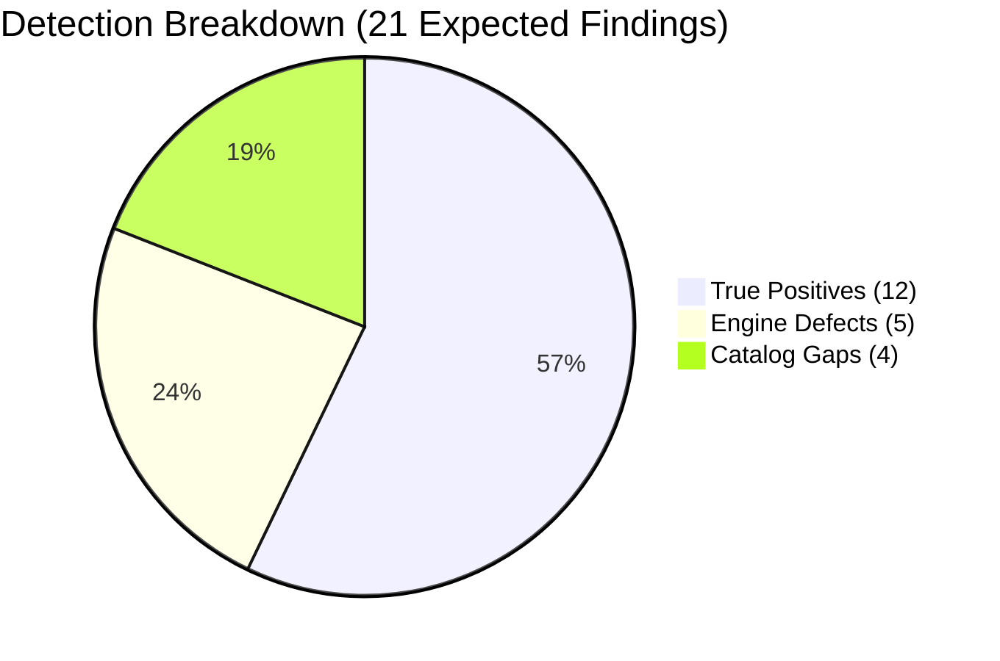

# OpenAudit M2 Detection Lab: Empirical Baseline Report

**Execution Date:** 2026-11-05  
**Target Environment:** Disposable Ubuntu 24.04 LTS containers (`openaudit-lab:ubuntu24.04`)  
**Engine Binary:** `openaudit-cli` (statically linked `aarch64-unknown-linux-musl`, 2.8 MB)  
**Scenarios Evaluated:** 25 total (19 misconfigurations, 6 controls)  

---

## 1. Executive Summary & Core Metrics

The controlled detection lab evaluated OpenAudit's local Linux audit engine across 25 isolated scenarios containing specific security misconfigurations and hardened controls.

| Metric | Measured Value | Target / Assessment |
|---|---|---|
| **Total Scenarios** | 25 | 19 misconfigurations, 6 controls |
| **Expected Findings** | 21 | Ground truth mapped in `expected.json` |
| **True Positives (TP)** | **12** | Accurately detected and classified |
| **False Positives (FP)** | **3** | Unintended alerts on secure/inconclusive hosts |
| **False Negatives (FN)** | **9** | 5 engine implementation defects, 4 catalog gaps |
| **Precision** | **80.0%** | $\frac{TP}{TP + FP} = \frac{12}{15}$ |
| **Recall** | **57.1%** | $\frac{TP}{TP + FN} = \frac{12}{21}$ |
| **JSON Schema Integrity** | **100% (25/25)** | Zero crashes, zero parse failures |
| **Evidence Redaction** | **100%** | Zero unredacted evidence flags leaked |
| **Asset ID Stability** | **Non-deterministic** | UUIDv4 regenerated per run |

---

## 2. Complete Scenario Results Matrix

| ID | Scenario Description | Kind | Expected Rule | Reported Rule | TP | FP | FN | Verdict | Failure Category |
|:---|:---|:---:|:---|:---|:---:|:---:|:---:|:---:|:---|
| **S00** | Hardened baseline | control | *None* | *None* | 0 | 0 | 0 | **PASS** | — |
| **S00b**| Hardened baseline (repeat) | control | *None* | *None* | 0 | 0 | 0 | **PASS** | — |
| **S01** | `PermitRootLogin yes` | misconfig | `linux.ssh.permit-root-login` | `linux.ssh.permit-root-login` | 1 | 0 | 0 | **PASS** | — |
| **S02** | `PasswordAuthentication yes` | misconfig | `linux.ssh.password-authentication` | `linux.ssh.password-authentication` | 1 | 0 | 0 | **PASS** | — |
| **S03** | `PasswordAuthentication` absent | misconfig | `linux.ssh.password-authentication` | *None* | 0 | 0 | 1 | **FAIL** | Engine Defect (implicit default) |
| **S04** | `PermitRootLogin yes` via `sshd_config.d` | misconfig | `linux.ssh.permit-root-login` | *None* | 0 | 0 | 1 | **FAIL** | Engine Defect (no `Include` support) |
| **S05** | Duplicate directive: 1st is `yes` | misconfig | `linux.ssh.permit-root-login` | *None* | 0 | 0 | 1 | **FAIL** | Engine Defect (last-match vs first-match) |
| **S06** | Duplicate directive: 1st is `no` | control | *None* | `linux.ssh.permit-root-login` | 0 | 1 | 0 | **FAIL** | Engine Defect (last-match vs first-match) |
| **S07** | Extra UID 0 account `toor` | misconfig | `linux.users.duplicate-root-uid` | `linux.users.duplicate-root-uid` | 1 | 0 | 0 | **PASS** | — |
| **S08** | Empty password hash in `/etc/shadow` | misconfig | `linux.users.empty-password` | *None* | 0 | 0 | 1 | **FAIL** | Rule Catalog Gap |
| **S09** | Empty firewall ruleset | misconfig | `linux.firewall.inactive` | `linux.firewall.inactive` | 1 | 0 | 0 | **PASS** | — |
| **S10** | UFW inactive, nftables active | control | *None* | `linux.firewall.inactive` | 0 | 1 | 0 | **FAIL** | Engine Defect (UFW short-circuit) |
| **S11** | Unprivileged audit, nftables active | control | *None* | `linux.firewall.inactive` | 0 | 1 | 0 | **FAIL** | Engine Defect (error $\neq$ inactive) |
| **S12** | Redis 6379 on `0.0.0.0` | misconfig | `linux.ports.database-publicly-exposed` | `linux.ports.database-publicly-exposed` | 1 | 0 | 0 | **PASS** | — |
| **S13** | MariaDB 3306 on `[::]` | misconfig | `linux.ports.database-publicly-exposed` | `linux.ports.database-publicly-exposed` | 1 | 0 | 0 | **PASS** | — |
| **S14** | Postgres 5432 + Mongo 27017 on `0.0.0.0` | misconfig | `ports...` (x2) | `ports...` (x1) | 1 | 0 | 1 | **FAIL** | Engine Defect (multi-finding short-circuit) |
| **S15** | Redis on non-standard port 6380 | misconfig | `linux.ports.database-publicly-exposed` | *None* | 0 | 0 | 1 | **FAIL** | Rule Catalog Gap (no process inspection) |
| **S16** | `/etc/shadow` mode 0644 | misconfig | `linux.fs.sensitive-file-permissions` | `linux.fs.sensitive-file-permissions` | 1 | 0 | 0 | **PASS** | — |
| **S17** | `/etc/passwd` mode 0666 | misconfig | `linux.fs.sensitive-file-permissions` | `linux.fs.sensitive-file-permissions` | 1 | 0 | 0 | **PASS** | — |
| **S18** | `/etc/sudoers.d/90-lab` mode 0666 | misconfig | `linux.fs.sensitive-file-permissions` | *None* | 0 | 0 | 1 | **FAIL** | Rule Catalog Gap (missing sudo drop-ins) |
| **S19** | `/etc/cron.d` directory mode 0777 | misconfig | `linux.fs.sensitive-file-permissions` | *None* | 0 | 0 | 1 | **FAIL** | Rule Catalog Gap (missing cron directories) |
| **S20** | Redis 6379 on `127.0.0.1` only | control | *None* | *None* | 0 | 0 | 0 | **PASS** | — |
| **S21** | `/etc/sudoers` mode 0666 | misconfig | `linux.fs.sensitive-file-permissions` | `linux.fs.sensitive-file-permissions` | 1 | 0 | 0 | **PASS** | — |
| **S22** | `/etc/shadow` 0644 + `/etc/passwd` 0666 | misconfig | `fs...` (x2) | `fs...` (x1) | 1 | 0 | 1 | **FAIL** | Engine Defect (multi-finding short-circuit) |
| **S23** | `/etc/ssh/sshd_config` mode 0666 | misconfig | `linux.fs.sensitive-file-permissions` | `linux.fs.sensitive-file-permissions` | 1 | 0 | 0 | **PASS** | — |

---

## 3. Root Cause Analysis

### Category A: Engine Implementation Defects (5 False Negatives, 3 False Positives)

1. **Rule Evaluation Short-Circuit (`Rule::evaluate` returns `Option<RuleFinding>`):**
   - **Affects:** S14, S22.
   - **Cause:** In `crates/engine/src/rule/mod.rs`, the `Rule` trait defines `fn evaluate(&self, ctx: &EvaluationContext) -> Option<RuleFinding>`. Consequently, `ExposedDatabasePortRule` and `SensitiveFilePermissionsRule` stop at the first vulnerable port/file found and return.
   - **Remediation:** Change `evaluate` signature to return `Vec<RuleFinding>` (or an iterator) so a single rule can emit findings for every vulnerable resource instance.

2. **OpenSSH Parser Semantics (First-Match vs Last-Match):**
   - **Affects:** S05 (FN), S06 (FP).
   - **Cause:** OpenSSH specification dictates that for all directives except `Include`, the **first value obtained wins**. The collector in `crates/engine/src/collector/ssh.rs` scanned the file line-by-line and assigned each matched directive, effectively implementing **last-match**.
   - **Remediation:** Record only the first appearance of a directive unless inside Match blocks.

3. **OpenSSH Implicit Default for Password Authentication:**
   - **Affects:** S03 (FN).
   - **Cause:** In OpenSSH, if `PasswordAuthentication` is absent, its default is `yes`. The rule `SshPasswordAuthenticationRule` (`crates/engine/src/rule/builtin.rs`) checked `config.password_authentication == Some(true)`. When absent (`None`), it evaluated as non-vulnerable.
   - **Remediation:** Treat `None` as `true` (vulnerable) for `PasswordAuthentication`, documenting the OpenSSH upstream default.

4. **Drop-in Directory Inclusion (`Include /etc/ssh/sshd_config.d/*.conf`):**
   - **Affects:** S04 (FN).
   - **Cause:** Modern Debian/Ubuntu distributions place security configurations inside `/etc/ssh/sshd_config.d/`. The SSH collector only read `/etc/ssh/sshd_config` without recursively following `Include` directives.
   - **Remediation:** Add glob-based recursive parsing for `Include` directives in `SshConfigCollector`.

5. **Firewall Priority & Error Status Discrimination:**
   - **Affects:** S10 (FP), S11 (FP).
   - **Cause:** `FirewallCollector` checked `ufw` first: if UFW was installed and inactive, it immediately returned `FirewallStatus::Inactive` without checking whether `nftables` or `iptables` had active rules. Additionally, running without root privilege caused command execution failures that were treated as "inactive firewall" rather than "unverifiable/inconclusive".
   - **Remediation:** A host is active if *any* backend is active. If all active checks fail due to permissions, return an inconclusive status rather than flagging an inactive firewall.

### Category B: Rule Catalog Gaps (4 False Negatives)

1. **Empty Password Hash Rule (`linux.users.empty-password`):**
   - **Affects:** S08 (FN).
   - **Remediation:** Add collector and rule checking `/etc/shadow` fields for accounts with empty password strings (`""`).

2. **Extended Sensitive Files & Sudo Drop-ins:**
   - **Affects:** S18, S19 (FN).
   - **Remediation:** Expand `SensitiveFilePermissionsRule` targets to include `/etc/sudoers.d/*`, `/etc/cron.*`, and sensitive system directories.

3. **Process-to-Port Correlation:**
   - **Affects:** S15 (FN).
   - **Remediation:** Collect process metadata via `/proc/<pid>/cmdline` or `ss -p` to flag database binaries running on arbitrary non-standard ports.

### Category C: Asset Determinism

- **Finding:** In S00 vs S00b, the audit outputs differed in `asset.id` (`2e2a1c02-...` vs `8e2c3f6a-...`).
- **Remediation:** Compute a deterministic `AssetId` by hashing stable host identity facts (e.g., `/etc/machine-id` or hostname + primary interface MAC).

---

## 4. Next Engineering Steps (Milestone M2.1 Plan)

1. **Refactor `Rule::evaluate`** from `Option<RuleFinding>` to `Vec<RuleFinding>` across `openaudit-engine`.
2. **Harden `SshConfigCollector`** with OpenSSH first-match semantics, `Include` glob resolution, and explicit default handling.
3. **Refactor `FirewallCollector`** to evaluate all available backends and differentiate between `Inactive` and `Inconclusive`/`PermissionDenied`.
4. **Implement Deterministic Asset Identification** based on `/etc/machine-id`.
5. **Re-run the Automated Lab Suite** to verify precision moves toward 100% and recall closes the 5 engine-defect gaps.
