# OpenAudit M2.1 Detection Reliability: Before-and-After Report

**Branch:** `m2.1-detection-reliability` (12 commits ahead of `main`)  
**Evaluation Date:** 2026-11-05  
**Engine Binary:** `openaudit-cli` (statically linked `aarch64-unknown-linux-musl`, 2.9 MB)  
**Test Environment:** Disposable Ubuntu 24.04 LTS containers (`openaudit-lab:ubuntu24.04`)  
**Scenarios:** 25 total — 19 misconfigurations, 6 hardened controls  

---

## 1. Headline Results

| Metric | M2 Baseline | M2.1 | Δ |
|---|---|---|---|
| **True Positives (TP)** | 12 | **21** | +9 |
| **False Positives (FP)** | 3 | **0** | −3 |
| **False Negatives (FN)** | 9 | **0** | −9 |
| **Precision** | 80.0% | **100.0%** | +20 pp |
| **Recall** | 57.1% | **100.0%** | +42.9 pp |
| **Scenarios Passing** | 13/25 | **25/25** | +12 |
| **JSON Schema Integrity** | 100% | **100%** | — |
| **Rules in catalog** | 6 | **7** | +1 |
| **Unit tests** | 51 | **63** | +12 |

```mermaid
xychart-beta
    title "Detection Metrics: M2 vs M2.1"
    x-axis ["Precision", "Recall", "Pass Rate"]
    y-axis "Percentage" 0 --> 100
    bar [80, 57.1, 52]
    bar [100, 100, 100]
```

---

## 2. Scenario-by-Scenario Comparison

| ID | Description | Kind | Expected | M2 Result | M2.1 Result | Change |
|:---|:---|:---:|:---:|:---:|:---:|:---:|
| S00 | Hardened baseline | control | 0 findings | ✅ PASS | ✅ PASS | — |
| S00b | Hardened baseline (repeat) | control | 0 findings | ✅ PASS | ✅ PASS | — |
| S01 | `PermitRootLogin yes` | misconfig | 1 finding | ✅ PASS | ✅ PASS | — |
| S02 | `PasswordAuthentication yes` | misconfig | 1 finding | ✅ PASS | ✅ PASS | — |
| **S03** | `PasswordAuthentication` absent (OpenSSH default = `yes`) | misconfig | 1 finding | ❌ FAIL (FN) | ✅ PASS | **Fixed** |
| **S04** | `PermitRootLogin yes` via `sshd_config.d` drop-in | misconfig | 1 finding | ❌ FAIL (FN) | ✅ PASS | **Fixed** |
| **S05** | Duplicate directive, first value is `yes` | misconfig | 1 finding | ❌ FAIL (FN) | ✅ PASS | **Fixed** |
| **S06** | Duplicate directive, first value is `no` (effective: no) | control | 0 findings | ❌ FAIL (FP) | ✅ PASS | **Fixed** |
| S07 | Extra UID 0 account `toor` | misconfig | 1 finding | ✅ PASS | ✅ PASS | — |
| **S08** | Empty password hash in `/etc/shadow` | misconfig | 1 finding | ❌ FAIL (FN) | ✅ PASS | **Fixed** |
| S09 | Empty nftables ruleset (no firewall) | misconfig | 1 finding | ✅ PASS | ✅ PASS | — |
| **S10** | UFW inactive, nftables active | control | 0 findings | ❌ FAIL (FP) | ✅ PASS | **Fixed** |
| **S11** | Unprivileged audit, nftables active | control | 0 findings | ❌ FAIL (FP) | ✅ PASS | **Fixed** |
| S12 | Redis 6379 on `0.0.0.0` | misconfig | 1 finding | ✅ PASS | ✅ PASS | — |
| S13 | MariaDB 3306 on `[::]` (IPv6 wildcard) | misconfig | 1 finding | ✅ PASS | ✅ PASS | — |
| **S14** | PostgreSQL 5432 + MongoDB 27017 both on `0.0.0.0` | misconfig | 2 findings | ❌ FAIL (FN) | ✅ PASS | **Fixed** |
| **S15** | Redis on non-standard port 6380 (process name detection) | misconfig | 1 finding | ❌ FAIL (FN) | ✅ PASS | **Fixed** |
| S16 | `/etc/shadow` mode `0644` | misconfig | 1 finding | ✅ PASS | ✅ PASS | — |
| S17 | `/etc/passwd` mode `0666` | misconfig | 1 finding | ✅ PASS | ✅ PASS | — |
| **S18** | `/etc/sudoers.d/90-lab` mode `0666` | misconfig | 1 finding | ❌ FAIL (FN) | ✅ PASS | **Fixed** |
| **S19** | `/etc/cron.d` directory mode `0777` | misconfig | 1 finding | ❌ FAIL (FN) | ✅ PASS | **Fixed** |
| S20 | Redis 6379 on `127.0.0.1` only (loopback-safe) | control | 0 findings | ✅ PASS | ✅ PASS | — |
| S21 | `/etc/sudoers` mode `0666` | misconfig | 1 finding | ✅ PASS | ✅ PASS | — |
| **S22** | `/etc/shadow` 0644 + `/etc/passwd` 0666 (multi-file) | misconfig | 2 findings | ❌ FAIL (FN) | ✅ PASS | **Fixed** |
| S23 | `/etc/ssh/sshd_config` mode `0666` | misconfig | 1 finding | ✅ PASS | ✅ PASS | — |

**12 previously failing scenarios now pass. Zero regressions.**

---

## 3. Defects Fixed

### Defect 1 — Rule Evaluation Short-Circuit
**Root cause:** `Rule::evaluate` returned `Option<RuleFinding>`, causing multi-instance rules to stop after the first finding.  
**Affected scenarios:** S14 (2 exposed database ports → reported 1), S22 (2 insecure files → reported 1).  
**Fix:** Changed the `Rule` trait signature in [`crates/engine/src/rule/mod.rs`](file:///Users/mac/Code/openaudit/crates/engine/src/rule/mod.rs) to return `Vec<RuleFinding>`. Updated all 6 existing rules plus the new `EmptyPasswordRule` to emit findings for every vulnerable resource instance.  
**Commits:** `25b0058`, `5967bec`

---

### Defect 2 — OpenSSH First-Match Semantics
**Root cause:** `SshConfigCollector` applied last-match (overwrote earlier values) instead of OpenSSH's specified first-match behaviour.  
**Affected scenarios:** S05 (FN: `PermitRootLogin yes` as first directive, overwritten by later `no`), S06 (FP: `PermitRootLogin no` as first directive, overwritten by later `yes`).  
**Fix:** Rewrote the SSH parser in [`crates/engine/src/collector/ssh.rs`](file:///Users/mac/Code/openaudit/crates/engine/src/collector/ssh.rs) to record only the first occurrence of each directive, matching OpenSSH upstream specification.  
**Commit:** `b68eeba`

---

### Defect 3 — OpenSSH Implicit Default for `PasswordAuthentication`
**Root cause:** When `PasswordAuthentication` is absent from `sshd_config`, the OpenSSH default is `yes` (enabled). The rule evaluated `None` as "not vulnerable".  
**Affected scenario:** S03 (FN: absent directive treated as disabled, missing the finding).  
**Fix:** `SshPasswordAuthenticationRule` in [`crates/engine/src/rule/builtin.rs`](file:///Users/mac/Code/openaudit/crates/engine/src/rule/builtin.rs) now treats `None` as `true`, explicitly documenting the OpenSSH upstream default.  
**Commit:** `b68eeba`

---

### Defect 4 — Include Directive Not Followed
**Root cause:** The SSH collector only read `/etc/ssh/sshd_config` and ignored `Include /etc/ssh/sshd_config.d/*.conf` directives. Modern Ubuntu/Debian distributions place security overrides inside `sshd_config.d/`.  
**Affected scenario:** S04 (FN: `PermitRootLogin yes` placed in `/etc/ssh/sshd_config.d/50-lab.conf`, invisible to the engine).  
**Fix:** Added glob-based `Include` resolution in `SshConfigCollector`. The `NoopSshFs` struct was extracted to module scope to support testing without the trait.  
**Commit:** `b68eeba`

---

### Defect 5 — Firewall Backend Priority and Error Discrimination
**Root cause (a):** `FirewallCollector` checked `ufw` first. If UFW was installed but inactive, it short-circuited without evaluating `nftables` or `iptables`. A host with UFW inactive but `nftables` active was incorrectly reported as having no firewall.  
**Root cause (b):** When commands failed with permission errors (unprivileged execution), the error was treated as "firewall inactive" instead of "firewall state unverifiable".  
**Affected scenarios:** S10 (FP: UFW inactive + nftables active → false alarm), S11 (FP: unprivileged + nftables active → false alarm).  
**Fix:** Added `FirewallStatus::Inconclusive` variant to [`crates/engine/src/collector/firewall.rs`](file:///Users/mac/Code/openaudit/crates/engine/src/collector/firewall.rs). Collector now evaluates all available backends; a host is `Active` if any backend reports activity. Command failures map to `Inconclusive`, not `Inactive`. The `FirewallInactiveRule` only fires for `FirewallStatus::Inactive`.  
**Commit:** `b47cac8`

---

## 4. Catalog Gaps Filled

### Gap 1 — Empty Password Hash Detection
**Rule added:** `linux.users.empty-password`  
**Scenario:** S08 — an account in `/etc/shadow` with an empty password hash field (`""`), allowing passwordless authentication.  
**Implementation:**
- [`crates/engine/src/collector/users.rs`](file:///Users/mac/Code/openaudit/crates/engine/src/collector/users.rs): Added `empty_password_accounts: Vec<String>` field and `parse_shadow_empty_passwords()` method parsing `/etc/shadow`.
- [`crates/engine/src/rule/builtin.rs`](file:///Users/mac/Code/openaudit/crates/engine/src/rule/builtin.rs): Added `EmptyPasswordRule` to `default_linux_rules()`.  
**Commits:** `e0532e4`, `5967bec`

---

### Gap 2 & 3 — Sensitive File Coverage: Sudo Drop-ins and Cron Directories
**Scenarios:** S18 (`/etc/sudoers.d/90-lab` mode `0666`), S19 (`/etc/cron.d` mode `0777`).  
**Implementation:** Extended `collect_critical()` in [`crates/engine/src/collector/permissions.rs`](file:///Users/mac/Code/openaudit/crates/engine/src/collector/permissions.rs) to scan:
- `/etc/sudoers.d/*` (drop-in overrides)
- `/etc/cron.d`, `/etc/cron.daily`, `/etc/cron.weekly`, `/etc/cron.monthly`, `/etc/cron.hourly`  
**Commit:** `dfa8ce2`

---

### Gap 4 — Process-Name-Based Database Port Detection
**Scenario:** S15 — `redis-server` running on non-standard port 6380 on `0.0.0.0`. Port-number-only identification missed it.  
**Implementation:**
- [`crates/engine/src/collector/ports.rs`](file:///Users/mac/Code/openaudit/crates/engine/src/collector/ports.rs): Added `process_name: Option<String>` field. Implemented `correlate_processes()` mapping socket inodes to process names via `/proc/<pid>/fd` symlinks → `/proc/<pid>/comm`.
- [`crates/engine/src/rule/builtin.rs`](file:///Users/mac/Code/openaudit/crates/engine/src/rule/builtin.rs): `ExposedDatabasePortRule` now checks both `port in KNOWN_DB_PORTS` and `process_name matches KNOWN_DB_PROCESSES`.  
**Commits:** `0450c00`, `5967bec`

---

## 5. Additional Engineering Improvements

| Change | File | Commit |
|---|---|---|
| Deterministic `AssetId` via SHA-256 seed | [`crates/core/src/id.rs`](file:///Users/mac/Code/openaudit/crates/core/src/id.rs) | `e17d42b` |
| `Asset::with_id()` constructor | [`crates/core/src/asset.rs`](file:///Users/mac/Code/openaudit/crates/core/src/asset.rs) | `59f26c2` |
| `read_dir()` / `read_link()` on `FileSystem` trait | [`crates/engine/src/collector/mod.rs`](file:///Users/mac/Code/openaudit/crates/engine/src/collector/mod.rs) | `381870c` |
| `machine_id` collected from `/etc/machine-id` | [`crates/engine/src/collector/os.rs`](file:///Users/mac/Code/openaudit/crates/engine/src/collector/os.rs) | `9665247` |
| Runner wired for deterministic IDs + multi-finding | [`crates/engine/src/runner.rs`](file:///Users/mac/Code/openaudit/crates/engine/src/runner.rs) | `d622dad` |

---

## 6. Asset ID Determinism

| Scenario | M2 Asset ID | M2.1 Asset ID |
|---|---|---|
| S00 | `2e2a1c02-7fe5-4b37-9922-976aa0fab1a4` | `82f4853b-8610-50a9-8b0c-47956c4729c3` |
| S00b | `8e2c3f6a-9303-4f33-8a24-abfbaae0c086` | `0b493abd-f79f-5cbd-a279-b66e62e0c5d6` |

**M2 behaviour:** Each run generated a fresh UUIDv4 (`AssetId::new()`). S00 and S00b were different containers with different IDs — expected, but non-deterministic across repeated scans of the same real host.

**M2.1 behaviour:** The engine now derives `AssetId` from `SHA-256("/etc/machine-id")` when available, falling back to `SHA-256("{org_id}:{hostname}")`. S00 and S00b are separate `docker run --rm` containers — each container gets its own ephemeral `/etc/machine-id` (or none at all in Ubuntu 24.04 Docker base images, where the file is absent). The fallback seed includes a fresh `org_id` per run, which is why the lab IDs differ.

> [!NOTE]
> This is **architecturally correct** behaviour. On a real persistent host, `/etc/machine-id` is stable across reboots. The same host scanned twice will produce the same `AssetId`. The lab evaluator flags it as "non-deterministic" because each Docker container is a different host by definition. This is a lab evaluation artifact, not an engine defect.

**Verification path for persistent hosts:** Run `openaudit-cli` twice on the same VPS with the same `org_id`. The `asset.id` fields in both reports will be identical.

---

## 7. Code Quality Verification

| Check | M2 | M2.1 |
|---|---|---|
| `cargo test --workspace` | 51 tests, 0 failures | **63 tests, 0 failures** |
| `cargo clippy --all-targets -- -D warnings` | 0 warnings | **0 warnings** |
| `cargo fmt --all --check` | Clean | **Clean** |
| Commits on branch | 0 (baseline on `main`) | **12** |

---

## 8. M2.1 Commit Log

| Commit | File | Description |
|---|---|---|
| `e17d42b` | `crates/core/src/id.rs` | Deterministic `AssetId::from_seed()` via SHA-256 |
| `59f26c2` | `crates/core/src/asset.rs` | `Asset::with_id()` constructor |
| `381870c` | `crates/engine/src/collector/mod.rs` | `read_dir()` + `read_link()` on `FileSystem` trait |
| `25b0058` | `crates/engine/src/rule/mod.rs` | `Rule::evaluate` → `Vec<RuleFinding>` |
| `9665247` | `crates/engine/src/collector/os.rs` | Collect `machine_id` from `/etc/machine-id` |
| `b68eeba` | `crates/engine/src/collector/ssh.rs` | First-match semantics + `Include` glob resolution |
| `b47cac8` | `crates/engine/src/collector/firewall.rs` | Multi-backend evaluation + `Inconclusive` state |
| `dfa8ce2` | `crates/engine/src/collector/permissions.rs` | Scan `sudoers.d/*` and `cron.*` directories |
| `e0532e4` | `crates/engine/src/collector/users.rs` | Parse `/etc/shadow` for empty password hashes |
| `0450c00` | `crates/engine/src/collector/ports.rs` | Correlate socket inodes → process names via `/proc` |
| `5967bec` | `crates/engine/src/rule/builtin.rs` | Multi-finding rules + `EmptyPasswordRule` |
| `d622dad` | `crates/engine/src/runner.rs` | Wire deterministic asset ID and multi-finding iteration |

---

## 9. Milestone Summary

| Milestone | Status | Evidence |
|---|---|---|
| **M2: Linux Auditing Engine** | ✅ Complete | Baseline frozen at `a14f667` on `main` |
| **M2.1: Detection Reliability** | ✅ Complete | 100%/100% precision/recall, 25/25 scenarios |
| **M2.2: Expanded Detection Coverage** | 🔜 Next | Proposed 55-scenario suite, additional rules |
| **M2.3: Independent Validation** | 🔜 Planned | Public report, reproducible evaluation environment |

> [!IMPORTANT]
> The M2 baseline report at [`docs/M2-BASELINE-REPORT.md`](file:///Users/mac/Code/openaudit/docs/M2-BASELINE-REPORT.md) is frozen and must not be overwritten. M2.1 results are additive evidence, not a revision.
