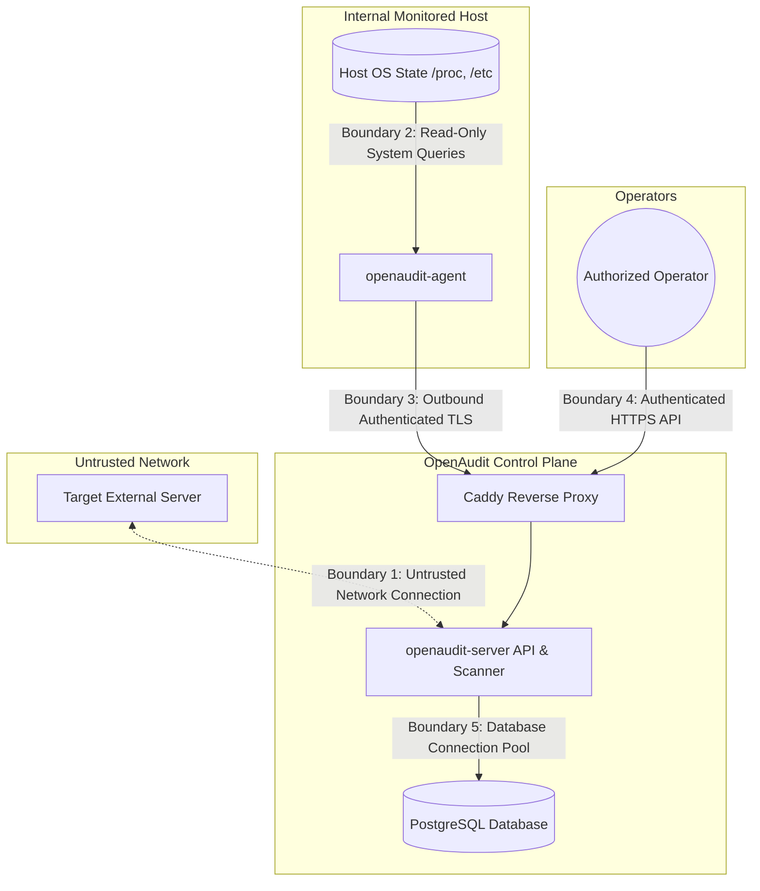

# OpenAudit Threat Model & Security Boundaries

This document defines the formal threat model for OpenAudit, detailing protected assets, trust boundaries, threat actors, attack surfaces, abuse cases, security controls, and residual risks.

---

## 1. Protected Assets

OpenAudit processes and stores sensitive data regarding monitored infrastructure. The primary assets requiring protection are:

| Asset | Description | Sensitivity | Security Objectives |
|---|---|---|---|
| **Target Infrastructure Integrity & Availability** | Monitored hosts, network endpoints, and web services. | Critical | Avoid service disruption, avoid CPU/memory exhaustion, prevent unauthorized port probing. |
| **Audit Findings & Vulnerability Data** | Identified misconfigurations, outdated packages, open ports, and security weaknesses. | High | Confidentiality (restricted to authorized operators), Integrity (tamper-proof audit records). |
| **Scan Evidence Payloads** | Raw command output, config excerpts, and response headers captured during checks. | High | Confidentiality, strict redaction of sensitive credentials, passwords, and private keys. |
| **Agent Authentication Credentials** | Tokens or cryptographic keys used by agents to authenticate with the control plane. | High | Confidentiality, instant revocability, protection against offline cracking. |
| **Control Plane API Tokens** | Operator and service accounts accessing the Axum REST API. | High | Confidentiality, strong hashing, role-based authorization. |
| **Scan Schedules & Scope Rules** | Target lists, CIDR definitions, and scheduling configurations. | Medium | Integrity, authorization validation. |

---

## 2. Trust Boundaries & Data Flow

### Trust Boundary Definitions

1. **Boundary 1 (Scanner to External Target):**
   - *Trust Level:* Untrusted. The target server may be malicious, deceptive, or misconfigured.
   - *Threats:* Server-Side Request Forgery (SSRF), DNS rebinding, infinite redirects, HTTP response bombs, connection hanging.
2. **Boundary 2 (Agent to Monitored Host):**
   - *Trust Level:* Semi-trusted. The agent runs locally on the host with minimum required permissions.
   - *Threats:* Privilege escalation, unauthorized host file tampering, accidental host resource exhaustion.
3. **Boundary 3 (Agent to Control Plane):**
   - *Trust Level:* Authenticated edge. Communication traverses public or private networks.
   - *Threats:* Man-in-the-Middle (MitM) eavesdropping, agent impersonation, replay attacks, forged audit reports.
4. **Boundary 4 (Operator to Control Plane API):**
   - *Trust Level:* Authenticated boundary.
   - *Threats:* Credential brute-forcing, token theft, privilege escalation, cross-tenant data access.
5. **Boundary 5 (Control Plane to Database):**
   - *Trust Level:* Internal trusted backend.
   - *Threats:* SQL injection, data leakage across organization boundaries, unauthorized schema tampering.

---

## 3. Threat Actors & Capabilities

- **TA1: Untrusted Internet Adversary:** Attempts to probe OpenAudit APIs, exploit SSRF vulnerabilities in agentless scanners, or intercept unencrypted traffic.
- **TA2: Malicious Web Target Operator:** A remote server operator who manipulates DNS responses, serves malicious redirects to internal IP ranges, or sends gigantic response payloads to crash the scanner.
- **TA3: Compromised Monitored Host / Rogue Agent:** A monitored server that has been breached. The attacker seeks to pivot from the agent to the control plane, forge audit reports, or access audit data of other hosts.
- **TA4: Malicious Tenant / Operator:** An authenticated user in a multi-tenant deployment attempting to view, modify, or scan assets belonging to another organization.
- **TA5: Compromised Third-Party Dependency:** A vulnerable or malicious Rust crate introduced into the build supply chain.

---

## 4. Abuse Cases & Mitigations

### AC1: Server-Side Request Forgery (SSRF) & Internal Network Port Scanning
- **Scenario:** An operator or attacker inputs an internal address (e.g., `http://169.254.169.254/latest/meta-data/` or `http://192.168.1.1/admin`) into an agentless scan target.
- **Mitigation:**
  - Strict default denylist blocking RFC 1918 private ranges, loopback (`127.0.0.0/8`), link-local (`169.254.0.0/16`), cloud metadata endpoints, Carrier-Grade NAT, and IPv6 ULA.
  - Internal network scanning requires explicit administrative registration in an authorized allowlist.
  - DNS resolution occurs prior to connection; the resolved IP is checked against the allowlist/denylist. The socket connects directly to the validated IP to prevent DNS rebinding TOCTOU attacks.

### AC2: Malicious Redirect to Private Infrastructure
- **Scenario:** A scanned public domain returns an HTTP 302 redirecting to `http://10.0.0.1/internal-status`.
- **Mitigation:**
  - Automatic redirect following is disabled by default.
  - When enabled, every redirect hop re-resolves the target IP and passes through the full SSRF validation filter before a new connection is initiated.
  - Maximum redirect depth is capped at 3 hops.

### AC3: Scanner Denial of Service (Decompression Bombs & Hanging Sockets)
- **Scenario:** A target serves a continuous stream of data (Slowloris response) or a gzip/deflate decompression bomb to exhaust scanner RAM.
- **Mitigation:**
  - Hard connection timeout (10 seconds) and read timeout (10 seconds).
  - Strict response body streaming limit (capped at 512 KB); any trailing bytes are discarded.
  - Strict concurrency limits on scan workers to prevent thread or file descriptor exhaustion.

### AC4: Agent Impersonation & Report Forgery
- **Scenario:** An attacker steals or guesses an agent credential and submits falsified clean audit reports to mask active breaches.
- **Mitigation:**
  - High-entropy cryptographic tokens issued only during an authenticated enrollment handshake.
  - Tokens stored hashed with Argon2id in the database.
  - Immediate token revocation capability in the control plane.
  - Audit logging of all submission timestamps and source IP addresses.

### AC5: Host Privilege Escalation via Agent Process
- **Scenario:** An attacker exploits a vulnerability in `openaudit-agent` to execute arbitrary root commands on the monitored host.
- **Mitigation:**
  - **No Remote Shell:** The agent codebase has zero capability to execute arbitrary commands from server instructions.
  - **Static Check Registry:** The agent only runs compiled, fixed check routines with static or strictly bounded inputs.
  - **Least Privilege:** The agent runs with unprivileged user permissions where possible, relying on specific POSIX read permissions (or minimal Linux capabilities) rather than full unrestricted root.
  - **Read-Only Invariant:** The agent does not open files with write permissions or invoke configuration-altering utilities.

### AC6: Leakage of Sensitive Credentials in Audit Evidence
- **Scenario:** An audit check captures configuration file contents containing database passwords or private API keys, storing them in plaintext in the database.
- **Mitigation:**
  - Pre-persistence evidence sanitizer parses and redacts recognized secret patterns (e.g., `password=`, `api_key=`, `BEGIN PRIVATE KEY`, AWS/GitHub token patterns).
  - Checks avoid capturing entire file dumps; they capture only relevant boolean results or specific configuration key-value lines.

### AC7: Cross-Tenant Data Access
- **Scenario:** An authenticated user from Organization A queries the API and retrieves findings from Organization B.
- **Mitigation:**
  - Every asset, scan, job, and finding record is strictly scoped to an `organization_id` foreign key.
  - All SQL queries require tenant scoping in `WHERE` clauses.
  - Defense-in-depth: PostgreSQL Row-Level Security (RLS) can be enforced at the connection level.

### AC8: Unauthorized Target Asset Scanning
- **Scenario:** A tenant attempts to use OpenAudit's agentless scanner to conduct aggressive reconnaissance against unowned third-party infrastructure.
- **Mitigation:**
  - Asset registration requires explicit domain ownership verification (e.g., DNS TXT token challenge or HTTP verification file) before active network scanning is unlocked.
  - Strict audit logging records who authorized the asset, when it was verified, and all scanning timestamps.
  - Rate limiting caps the frequency and concurrency of scans targeting any single domain or IP address.

### AC9: Malicious Scanning Rules & Parameter Injection
- **Scenario:** An attacker modifies declarative YAML rule definitions or injects shell metacharacters into check parameters to achieve arbitrary code execution.
- **Mitigation:**
  - Rules are declarative and statically validated against a strict schema; dynamic script execution (e.g. bash or python evaluation) is forbidden.
  - Check runners use structured, typed Rust APIs instead of string-interpolated shell command strings.
  - Rule files are cryptographically checksummed and bundled into the binary or loaded only from tamper-protected filesystem directories owned by root.

### AC10: Database Compromise & SQL Injection
- **Scenario:** An adversary exploits an API input field to execute arbitrary SQL commands against PostgreSQL.
- **Mitigation:**
  - Exclusive use of SQLx compiled, parameterized queries; string concatenation of SQL statements is forbidden.
  - Application database user runs with least-privilege permissions (no `SUPERUSER` privileges, cannot alter schema or execute external server extensions).
  - PostgreSQL connection uses TLS with certificate verification.

### AC11: Worker Exhaustion & Job Queue Flooding
- **Scenario:** An attacker floods the system with thousands of scan jobs to starve the worker queue and deny service to legitimate audits.
- **Mitigation:**
  - Per-organization rate limits and concurrent scan quotas enforced at the API boundary before jobs are enqueued.
  - Priority-based job scheduling (`ORDER BY priority DESC, scheduled_at ASC`) ensuring operational jobs preempt bulk historical audits.
  - Worker timeout enforcement: jobs exceeding their maximum wall-clock runtime are automatically marked failed and killed.

### AC12: Supply Chain & Dependency Compromise
- **Scenario:** A compromised or malicious transitive crate is introduced into the Rust workspace.
- **Mitigation:**
  - Zero unnecessary third-party dependencies; all crates are reviewed for maintenance status and security track record.
  - Workspace lints forbid `unsafe_code` across all crates (`unsafe_code = "forbid"`).
  - Automated CI dependency audits with `cargo audit` in continuous integration to catch known vulnerability advisories immediately.
  - Pinned dependencies via tracked `Cargo.lock`.

### AC13: Control-Plane Compromise & Administrative Takeover
- **Scenario:** An attacker compromises the Axum server process or steals administrative API credentials.
- **Mitigation:**
  - Server process runs in an unprivileged container with a read-only root filesystem and dropped capabilities.
  - Strong Argon2id password hashing with modern salt generation and memory parameters.
  - Mandatory session revocation endpoints allowing administrators to invalidate all issued tokens instantly.
  - Blast radius containment: agents only poll outbound and cannot be commanded to execute arbitrary code even if the server is compromised.

### AC14: Compromised Agent Blast Radius & Rogue Report Poisoning
- **Scenario:** A monitored host is breached, and the attacker uses the installed agent's credentials to send fabricated reports or pivot.
- **Mitigation:**
  - The agent holds only a scoped, revocable bearer token with permissions limited strictly to `POST /api/v1/agent/reports` and `POST /api/v1/agent/heartbeat`.
  - The agent has zero read access to other assets, organizations, or control-plane settings.
  - Immediate agent revocation in the control plane invalidates the token, dropping all subsequent requests.

---

## 5. Residual Risks & Operational Assumptions

1. **Host Compromise Prior to Agent Installation:** If a host is already compromised by a rootkit or kernel-level malware, the agent's read-only queries (e.g. `/proc`) may be tampered with by the adversary. OpenAudit does not claim to replace a dedicated kernel-level rootkit detector.
2. **Out-of-Band Network Disruption:** Aggressive port probing against fragile legacy network equipment could cause service instability. OpenAudit limits agentless network checks to non-destructive, non-flooding protocols (standard HTTP/TLS handshakes and DNS queries).
3. **Operator Authorization Responsibility:** The control plane assumes the administrator configuring scan targets has legal authority and operational consent to inspect the designated endpoints.
